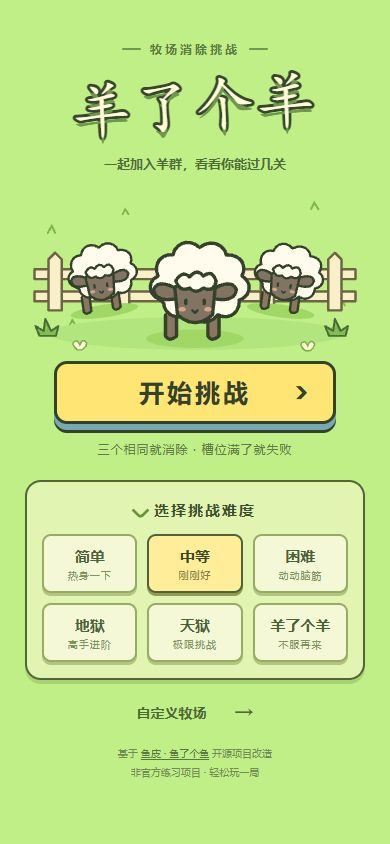
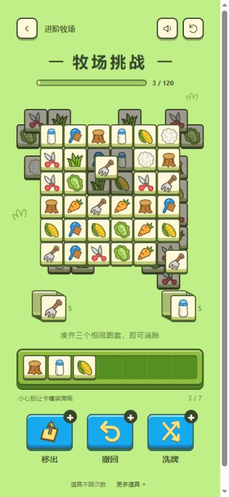

# 羊了个羊 · 牧场消除挑战

基于鱼皮「鱼了个鱼」的 Vue 3 前端项目，按羊了个羊经典牧场视觉重新设计。

- 浅绿草地、奶油立体方牌、绿色七格卡槽、蓝色道具按钮。
- 21 种原创 SVG 农场图案，仍支持自定义文字和表情。
- 点击按压、飞入卡槽、同类排序、落位回弹、匹配闪光与星点、平滑补位。
- 撤回与移出回程动画，洗牌动画，统一的成功/失败面板；可关闭音效。
- 保留六种难度与无限道具，支持键盘焦点及减少动态效果偏好。
- 修复槽位计数、随机堆撤回、重新开局、边界收缩与连续点击的状态问题。

[视觉研究与来源](doc/design-research.md)记录了官方素材库、2026 年版本信息、视觉依据和动效证据边界。本项目使用原创重绘资源；动画参数是实现调校值。

 

本地运行（使用仓库的 Yarn Classic 锁文件）：

```sh
npx --yes yarn@1.22.22 install --frozen-lockfile
npm run dev
```

验证和生产预览：

```sh
npm test
npm run build
npm run preview
```

`npm test` 包含延迟匹配结算、最后一槽消除、三种来源撤回、重复开局、高难度坐标、牌量守恒与旧配置迁移的回归测试。无需添加测试依赖。

## 改版前的上游项目说明

> 被羊了个羊虐了百遍后，我自己做了一个！

在线体验：http://yulegeyu.yupi.icu

游戏视频：https://www.bilibili.com/video/BV1Pe411M7wh

相关文章：https://mp.weixin.qq.com/s/D_I1Tq-ofhKhlp0rkOpaLA

游戏截图（自定义了图案）：


游戏特色：

1. 支持选择难度（4 种）
2. 支持自定义难度
3. 支持自定义动物图案（比如 🐔🏀）
4. 可以无限使用技能（道具）
5. 不需要看广告
6. 能通关

> 补一句：就出于兴趣做了几个小时，有 bug 正常哈哈，欢迎 PR~

简单说下实现原理，主要有 4 个点：

1. 游戏全局参数：做游戏的同学都知道，游戏中会涉及很多参数，比如槽位数量、层数等等。我们要将这些参数抽取成统一的全局变量，供其他变量使用。从而做到修改一处，游戏自动适配。还可以提供页面来让用户自定义这些参数，提高游戏的可玩性。
2. 网格：为了让块的分布相对规整、并且为计算坐标提供方便，我将整个游戏画布分为 24 x 24 的虚拟网格，类似一个棋盘。一个块占用 3 x 3 的格子。
3. 随机生成块：包括随机生成方块的图案和坐标。首先我根据全局参数计算出了总块数，然后用 shuffle 函数打乱存储所有动物图案的数组，再依次将数组中的图案填充到方块中。生成坐标的原理是随机选取坐标范围内的点，坐标范围可以随着层级的增加而递减，即生成的图案越来越挤，达到难度逐层加大的效果。
4. 块的覆盖关系：怎么做到点击上层的块后，才能点下层的块呢？首先要给每个块指定一个层级属性。然后有两种思路，第 1 种是先逐层生成，然后每个格子里层级最高的块依次判断其周围格子有没有块层级大于它；第 2 种是在随机生成块的时候就给相互重叠的块绑定层级关系（即谁覆盖了我？我覆盖了谁？）。这里我选择了第 2 种方法，感觉效率会高一些。

## Deploy to Cloudflare Pages (Free)

In **Workers & Pages → Create application → Pages**, import your GitHub fork
using the native Git integration. Authorize only this repository when possible.

| Setting | Value |
| --- | --- |
| Plan | Free |
| Framework preset | Vue |
| Production branch | `master` (preserve the fork's actual default branch) |
| Build command | `npm run build` |
| Build output directory | `dist` |
| Root directory | Repository root (leave blank) |
| Build environment variable | `YARN_VERSION=1.22.22` for production and previews |
| Node.js | `24.19.0`, pinned in `.node-version` |

Keep automatic production deployments enabled. Pages installs dependencies from
the existing `yarn.lock`; use Yarn Classic rather than generating a second lockfile.
Use the free `*.pages.dev` address. No Functions, database, paid service, or custom
domain is needed. The existing hash routes (`/#/`, `/#/game`, `/#/config`) work on
static hosting without redirects.

To reproduce the build locally:

```sh
npx --yes yarn@1.22.22 install --frozen-lockfile
npm run build
npm run preview
```

References: [Pages GitHub integration](https://developers.cloudflare.com/pages/configuration/git-integration/github-integration/)
and [build environment versions](https://developers.cloudflare.com/pages/configuration/build-image/).

### Attribution and licensing

Original game by [程序员鱼皮 (liyupi)](https://github.com/liyupi/yulegeyu).
The upstream repository has no explicit license file or `package.json` license
declaration at the source revision used by this fork. No license has been added;
the README's open-source wording alone does not specify license terms.


